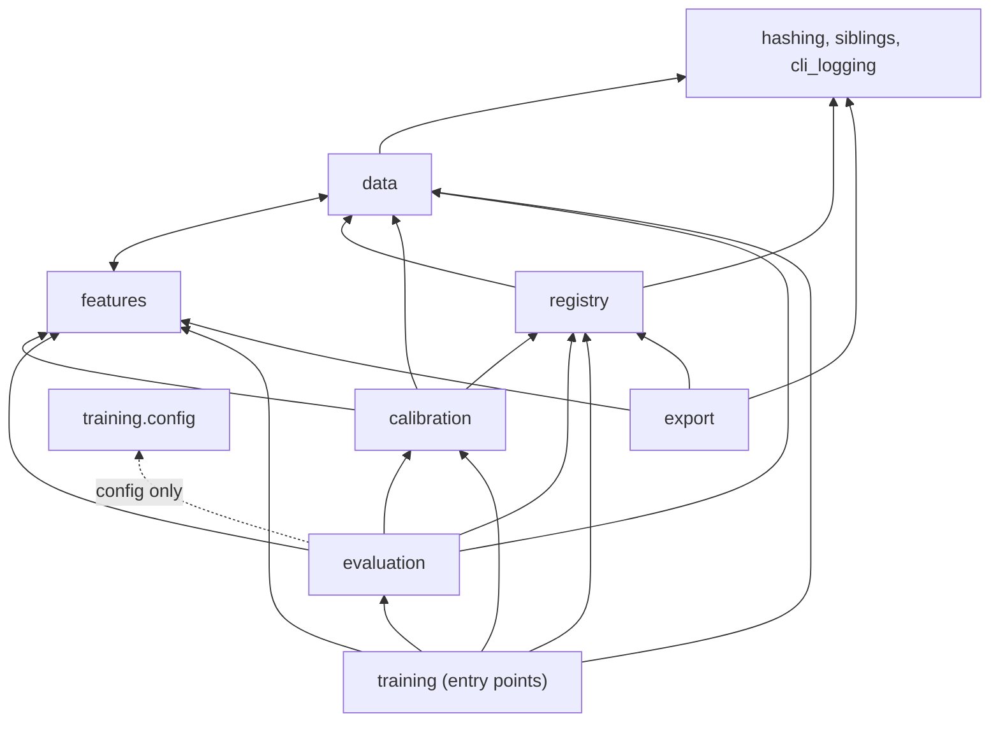
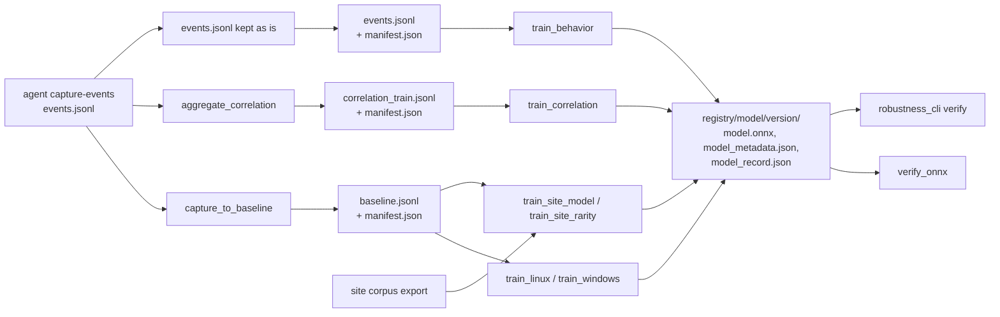

# Architecture overview

This page covers how the `synthaea_ml` package is organized: which subpackage does what, which
way imports may point, and how data moves from an agent capture to a model version in the
registry. For the exact feature definitions see [features.md](features.md); for the trainers
see [training.md](training.md).

## What the pipeline produces

The agent scores events with Isolation Forest models exported to ONNX. This repository builds
those models and everything that justifies shipping one:

| Output | Where | Consumed by |
| --- | --- | --- |
| `model.onnx` | `registry/<model>/<version>/` | The agent's [`ml` crate](https://github.com/synthaea-lab/agent/blob/main/docs/detection/ml.md), through onnxruntime |
| `model_metadata.json` | next to the model | The agent's scorer: conformal threshold and per-feature bounds |
| `model_record.json` | next to the model | [`verify_onnx`](../synthaea_ml/export/verify_onnx.py) and the robustness gate: dataset hashes, robustness cards, scenario replays, hyperparameters |
| `card.md` | next to the model | Reviewers: purpose, data, metrics, limitations |
| Golden fixtures | [`tests/fixtures/`](../tests/fixtures/README.md) and the agent's `crates/ml/tests/fixtures/` | The parity tests on both sides |
| Calibration reports | [`reports/calibration/`](../reports/README.md) | The likelihood-ratio constants of the agent's correlator |

The models are grouped in tiers by what they score:

| Tier | Scores | Features | Trainer |
| --- | --- | --- | --- |
| T0 | One command line | 9 command-line features | [`train_linux`](../synthaea_ml/training/train_linux.py), [`train_windows`](../synthaea_ml/training/train_windows.py) |
| T1 | One process incarnation | 9 command-line + 8 correlation = 17 | [`train_behavior`](../synthaea_ml/training/train_behavior.py) |
| T2 | One pid's correlator window | 8 correlation features | [`train_correlation`](../synthaea_ml/training/train_correlation.py) |
| Site | One command line, per tenant | 9 command-line, or 9 + 2 rarity | [`train_site_model`](../synthaea_ml/training/train_site_model.py), [`train_site_rarity`](../synthaea_ml/training/train_site_rarity.py) |

T3 (fleet rarity and per-site baselines) runs on the control plane. This repository holds the
rarity feature definition and the per-site trainers that consume a site corpus exported from
it, not the fleet service itself.

## Package map

| Subpackage | Responsibility |
| --- | --- |
| [`data/`](../synthaea_ml/data) | Reading agent captures and baselines ([`jsonl`](../synthaea_ml/data/jsonl.py), [`wire`](../synthaea_ml/data/wire.py), [`canonical`](../synthaea_ml/data/canonical.py)), building datasets ([`capture_to_baseline`](../synthaea_ml/data/capture_to_baseline.py), [`aggregate_correlation`](../synthaea_ml/data/aggregate_correlation.py), [`behavior_dataset`](../synthaea_ml/data/behavior_dataset.py), [`common_set`](../synthaea_ml/data/common_set.py)) and the dataset [`manifest`](../synthaea_ml/data/manifest.py) |
| [`features/`](../synthaea_ml/features) | Feature extractors, each the reference for a Rust twin in the agent |
| [`calibration/`](../synthaea_ml/calibration) | Conformal thresholds and feature bounds ([`calibrate_conformal`](../synthaea_ml/calibration/calibrate_conformal.py)); empirical likelihood ratios ([`calibrate_llr`](../synthaea_ml/calibration/calibrate_llr.py)) |
| [`training/`](../synthaea_ml/training) | The shared [configuration](../synthaea_ml/training/config.py) and [pipeline steps](../synthaea_ml/training/pipeline.py), and one entry point per trainer |
| [`evaluation/`](../synthaea_ml/evaluation) | [Scenario replay](../synthaea_ml/evaluation/scenario_replay.py), [robustness](../synthaea_ml/evaluation/robustness.py) with its [mutators](../synthaea_ml/evaluation/mutations) and [gate](../synthaea_ml/evaluation/robustness_cli.py), the [lineage-gain measurement](../synthaea_ml/evaluation/t1_lineage_gain.py), and an [ONNX model adapter](../synthaea_ml/evaluation/onnx_model.py) |
| [`registry/`](../synthaea_ml/registry) | The version directory [layout](../synthaea_ml/registry/layout.py), the record [types](../synthaea_ml/registry/records.py), its [codec](../synthaea_ml/registry/codec.py), [dataset binding](../synthaea_ml/registry/dataset_binding.py) and [provenance checks](../synthaea_ml/registry/provenance.py) |
| [`export/`](../synthaea_ml/export) | [`verify_onnx`](../synthaea_ml/export/verify_onnx.py), the runtime and provenance check of registry models |
| Top level | [`hashing`](../synthaea_ml/hashing.py) (the one SHA-256 helper), [`siblings`](../synthaea_ml/siblings.py) (where the sibling checkouts are), [`cli_logging`](../synthaea_ml/cli_logging.py) |

## Dependency direction

The package is layered so that what ships, and what verifies what ships, never depends on a
training script:

- `data` and `features` use each other: `features.t1` reads the canonical command line from
  `data.canonical`, and `data.common_set` builds `features.rarity` snapshots. Neither imports
  anything above them.
- The record types live in `registry.records`; `calibration` re-exports `ConformalCalibration`
  and `FeatureBounds` from there, so the registry owns its schema.
- Shared values that several layers need live below the trainers: the sanity samples in
  [`features/sanity_samples.py`](../synthaea_ml/features/sanity_samples.py), the
  hyperparameters and thresholds in [`training/config.py`](../synthaea_ml/training/config.py).
- [`tests/test_import_direction.py`](../tests/test_import_direction.py) enforces the two rules
  that matter most: importing `export.verify_onnx` loads no `synthaea_ml.training` module, and
  importing `evaluation.t1_lineage_gain` loads no `training.train_*` script (it may read
  `training.config`).

## From capture to registry

1. The agent records events with `agent capture-events` on a host doing normal work. The
   scenarios repository provides the [benign and malicious capture
   workloads](https://github.com/synthaea-lab/scenarios/blob/main/docs/ml-capture.md). Raw
   captures are kept outside this repository.
2. A dataset builder turns the capture into the samples file of one dataset shape, and
   `synthaea-ml-manifest write` records its provenance and SHA-256 next to it
   ([datasets.md](datasets.md)).
3. A trainer verifies every manifest it is given, extracts features, holds out a calibration
   split, fits the forest, sets the conformal threshold, exports ONNX, optionally runs the
   robustness evaluation, and writes the model record ([training.md](training.md)).
4. `verify_onnx` loads every registry model under onnxruntime and re-verifies the hashes its
   record binds; `robustness_cli verify` holds its robustness cards to the gate
   ([registry.md](registry.md), [evaluation.md](evaluation.md)).
5. A model reaches the agent as content, separate from the agent binary. The agent reads
   `model.onnx` and `model_metadata.json` from a registry-shaped directory and degrades to "no
   ML evidence" when a model is missing or invalid.

## Parity with the agent

Every feature vector is defined twice: in `synthaea_ml/features/` and in the agent's
`crates/ml`. A model trained on Python vectors scores correctly on the endpoint only if Rust
builds the same vector from the same event, so each extractor is pinned by a golden file that
both test suites read. The same holds for the canonical command-line form, the ONNX inference
path and score attribution. [features.md](features.md) lists each seam and
[testing.md](testing.md#golden-fixtures) its fixture.

## Known gaps

- None of the committed registry models meets the ship criteria. The two T0 models predate the
  model record and serve as verification inputs ([registry.md](registry.md#committed-models)).
- No entry point writes scenario replays into a model record yet; `run_replay` exists as a
  library function ([evaluation.md](evaluation.md#scenario-replay)).
- No T1 or T2 model has been trained on a committed dataset. The T2 trainer still accepts a
  deprecated no-argument mode that reads and writes inside the package
  ([training.md](training.md#t2-correlation-scorer)).
- The rarity feature has a Rust extractor, but no agent scorer loads an 11-feature model yet
  ([features.md](features.md#rarity)).
