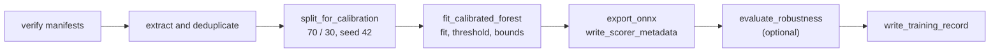

# Training

Every model in this repository is a scikit-learn `IsolationForest` trained on benign data
only, then exported to ONNX. This page covers the configuration all trainers share, the steps
they run in common, and what each trainer adds. Calibration itself is detailed in
[calibration.md](calibration.md), the robustness evaluation in [evaluation.md](evaluation.md),
and the files a trainer writes in [registry.md](registry.md).

## Shared configuration

[`training/config.py`](../synthaea_ml/training/config.py) holds every value that two trainers,
or a trainer and an evaluation tool, must agree on:

| Name | Value | Used for |
| --- | --- | --- |
| `RANDOM_SEED` | 42 | The forest, the calibration split and the mutation PRNG |
| `CMDLINE_FOREST` | 100 trees, contamination 0.05 | T0 and both site trainers |
| `BEHAVIOR_FOREST` | 100 trees, contamination 0.05 | T1 (provisional) |
| `CORRELATION_FOREST` | 100 trees, contamination 0.02 | T2 (provisional) |
| `BEHAVIOR_MIN_SAMPLES` | 20 | Fewest distinct T1 vectors a run accepts |
| `CALIBRATION` | 5 FP per endpoint per day, 1000 benign events per endpoint per day, 5% bounds margin | The conformal threshold and feature bounds |
| `FLOOR_TOLERANCE` | escape rate +0.05, median degradation +0.10 | The site trainers' floor checks |

`IsolationForestConfig.hyperparameters()` returns the keyword arguments of `IsolationForest`,
which is also what the model record stores, so a record names exactly what the forest was built
with. [`tests/test_training_config.py`](../tests/test_training_config.py) pins the values.

The T0 contamination of 0.05 is deliberate. At 0.02 the known `curl` health-check false positive
disappeared, but the score of a short, real malicious command line (`base64 -d`) collapsed to
almost zero on a baseline of a few dozen samples. A clear signal on the true positive was
preferred, since a deterministic rule covers that case regardless of the model. Do not tune the
provisional T1 and T2 values on synthetic data.

## The shared steps

[`training/pipeline.py`](../synthaea_ml/training/pipeline.py) holds the steps every
calibrated trainer runs in order:



1. **Verify.** Each `--dataset` directory goes through
   [`dataset_version_from_manifest`](../synthaea_ml/registry/dataset_binding.py), which
   re-hashes the samples file before anything else runs. A mismatch raises `ValueError` and no
   model is written.
2. **Extract and deduplicate.** Each trainer builds its own feature matrix (below) as float32.
3. **Split.** `split_for_calibration` holds out 30% of the rows (`train_test_split` with
   `RANDOM_SEED`) to calibrate the threshold.
4. **Fit and calibrate.** `fit_calibrated_forest` fits the forest on the training rows, sets the
   conformal threshold on the held-out rows, and bounds every feature by the training range plus
   the margin.
5. **Export.** `export_onnx` converts with skl2onnx at a pinned opset (`""`: 18, `ai.onnx.ml`:
   3; the installed skl2onnx does not follow the newer `ai.onnx.ml` domain). The input shape
   comes from one training row. `write_scorer_metadata` writes `model_metadata.json`.
6. **Evaluate.** With `--robustness-scenarios`, `evaluate_robustness` produces one robustness
   card per scenario, at tier T0 or T1 and with the mutation seed `RANDOM_SEED`. A failed
   evaluation raises, with a note naming the scenario: a run never writes a record with missing
   cards and exits 0. The trainers evaluate at the forest's decision boundary (threshold 0), not
   at the calibrated threshold.
7. **Record.** Each trainer writes `model_record.json` itself, because what it binds differs.

[`tests/test_trainer_artifacts.py`](../tests/test_trainer_artifacts.py) rebuilds the three
artifacts from direct scikit-learn, skl2onnx and calibration calls and requires the trainers to
produce the same bytes, so a refactor of the shared steps cannot change a model.

## T0: command line

[`train_linux`](../synthaea_ml/training/train_linux.py) and
[`train_windows`](../synthaea_ml/training/train_windows.py) differ only in the baseline format
they read and their sanity samples. There is one model per operating system: mixing Linux and
Windows command lines in one score space dilutes both.

- **Input:** one or more `--dataset` directories with `baseline.jsonl` and `manifest.json`.
  Several datasets are concatenated, each recorded as its own dataset version.
- **Samples:** the canonical command line of each record, deduplicated per dataset and again
  across all of them, in order.
- **Output:** `model.onnx`, `model_metadata.json`, `model_record.json` in `--output-dir`, then
  the scikit-learn scores of the platform's sanity samples on stdout.

```bash
synthaea-ml-train-linux \
    --dataset datasets/baselines/<dataset-name> \
    --output-dir registry/cmdline-iforest-linux/0.2.0 \
    --robustness-scenarios ../scenarios/scenarios/beacon.yaml ../scenarios/scenarios/argv.yaml \
    --robustness-events malicious-events.jsonl
```

`--robustness-events` should hold malicious exec events matching the scenarios: an escape rate
is only defined on samples the model detected before mutation, and benign events make the
evaluation fail ([evaluation.md](evaluation.md#robustness)).

## T1: behavior

[`train_behavior`](../synthaea_ml/training/train_behavior.py) trains on the 17-feature
[T1 vector](features.md#t1).

- **Input:** one or more directories with `events.jsonl` (a raw agent capture of normal
  activity) and a manifest written for that file name.
- **Samples:** one record per process incarnation
  ([`behavior_dataset`](datasets.md#behavior-capture)), deduplicated by feature vector across
  all datasets, so an identical behavior seen 10 000 times adds one row. Fewer than 20 distinct
  vectors raises `ValueError`: a 70/30 split and a percentile threshold on less are noise.
- **Robustness:** at tier T1, with the command-line mutators. The parent is not in the vector,
  so no lineage mutator runs. `--robustness-events` is a capture of malicious activity in the
  agent's wire format; T1 then computes each exec's correlation context from that file.
- **Output:** the same three files.

The agent's T1 scorer requires metadata carrying both the threshold and bounds for exactly these
17 features, in order. The agent does not load a T1 model yet.

## T2: correlation scorer

[`train_correlation`](../synthaea_ml/training/train_correlation.py) trains on the 8
[correlation features](features.md#correlation), one vector per pid.

- **Input:** `--dataset` with `correlation_train.jsonl` and its manifest, and `--output-dir`.
  The two options go together.
- **Robustness:** none. T2 has no mutators yet, and the trainer takes no robustness options.
- **Output:** the same three files, then the scores of four synthetic sanity vectors.
- **Gate:** vectors with `event_count < 3` are not excluded at training time. The agent's scorer
  returns no score for them; the trainer only prints the reminder.

Run without options, the trainer reads and writes inside the package source tree, verifies no
manifest and writes no record. That mode is deprecated, emits a `FutureWarning`, and will be
removed. The agent looks for this model as `correlation-iforest-<os>/0.1.0/model.onnx`; when
present, its score becomes a capped log-odds term in the correlator's belief, never an alert on
its own.

## Per-site models

The per-site trainers rebuild a T0 model for one tenant from a [site corpus](datasets.md#site-corpora)
and refuse to write one that is worse than its reference.

### `train_site_model`

[`train_site_model`](../synthaea_ml/training/train_site_model.py) concatenates the global
baseline (`--global-dataset`, verified) and the site corpus's command lines, deduplicated with
the global samples first, and fits `CMDLINE_FOREST` on all of them (at least 10 rows). It does
not calibrate a threshold and writes no `model_metadata.json`.

The **global-model floor** runs when both `--robustness-scenarios` and `--global-model` are given
(a warning is printed if only one is): the site model and the global model are each evaluated on
the scenario at tier T0 with the same seed, and the site model fails if its escape rate exceeds
the global model's by more than 0.05, or its median degradation by more than 0.10
([`training/floor.py`](../synthaea_ml/training/floor.py)). A failure raises before anything is
exported. `--global-model` is a pickled scikit-learn model the operator trained locally; it is
unpickled, so never pass a file of unknown origin.

The record binds the global baseline's manifest and the site corpus by hash, with empty
robustness cards and scenario replays.

### `train_site_rarity`

[`train_site_rarity`](../synthaea_ml/training/train_site_rarity.py) adds the two
[rarity features](features.md#rarity) and measures their effect instead of assuming it. It needs
at least 60 exec events.

1. Rebuild the point-in-time common set over all corpus records, then take the exec records in
   time order.
2. Split by **time**: the first 70% to train, the next 15% to calibrate, the last 15% to test. A
   random split would put near-duplicates of an event on both sides and flatter both models.
3. Train two models on the same split: the cmdline-only baseline (9 features) and the candidate
   (11). Each is calibrated on its slice to the same FP budget and scored on the test slice. The
   test slice is benign, so the share flagged there is each model's empirical false-positive
   rate.
4. Check the **rarity floor**. A fresh fleet has no usable snapshot, so its rarity is withheld
   (0, 0). With the rarity forced to withheld, the candidate may flag at most one percentage
   point more of the test slice than the baseline (`WITHHELD_FP_MARGIN`), and, with
   `--robustness-scenarios`, must hold the floor tolerances against the baseline on each
   scenario, each model at its own calibrated threshold. A scenario the baseline detects none of
   is skipped; one the candidate detects none of while the baseline does is a failure.
5. With `--global-model-dir`, check the same two conditions against the **shipped global model**
   (`model.onnx` scored through onnxruntime, its threshold read from `model_metadata.json`, or 0
   without metadata, as in the agent). Without it, the record says the global comparison was not
   checked.
6. Write the model only if every floor passed. All failures are collected and reported together.

On a real corpus almost every row has a known rarity, so a forest learns the withheld state as
rare and fails the floor. `--withhold-fraction` sets the rarity of that share of the training
rows (never the calibration or test rows) to withheld, so the model learns the state of a new
fleet. The record's `extra` carries the run's settings, the known fraction, each false-positive
rate, the baseline threshold and one line per floor stating what it covered; the keys and their
formats are pinned by [`tests/test_site_rarity_record.py`](../tests/test_site_rarity_record.py).

Detection with the rarity known is not measured: scenario events carry no image hash, so only
the withheld state can be scored on them.

## Adding a trainer

- Read datasets through `dataset_version_from_manifest` before touching a sample.
- Take hyperparameters from `training/config.py`, adding a named config if the family is new.
- Reuse the steps of `training/pipeline.py`, and write the record with
  [`write_training_record`](../synthaea_ml/registry/codec.py), passing the hyperparameters,
  calibration and bounds.
- Give the module a `main(argv) -> int`, register it in `[project.scripts]`, and call
  `configure_cli_logging()` ([development.md](development.md#command-line-conventions)).
- Add a byte-pinning test like `test_trainer_artifacts.py` for its outputs.
